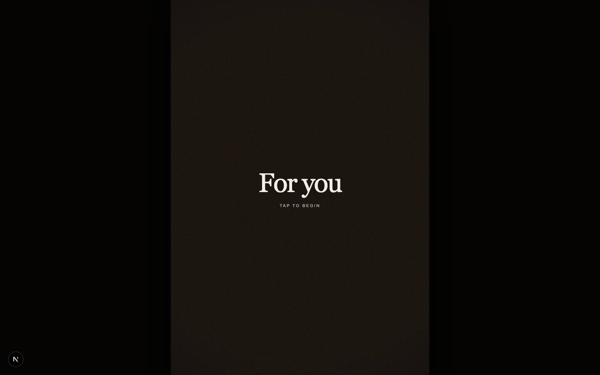
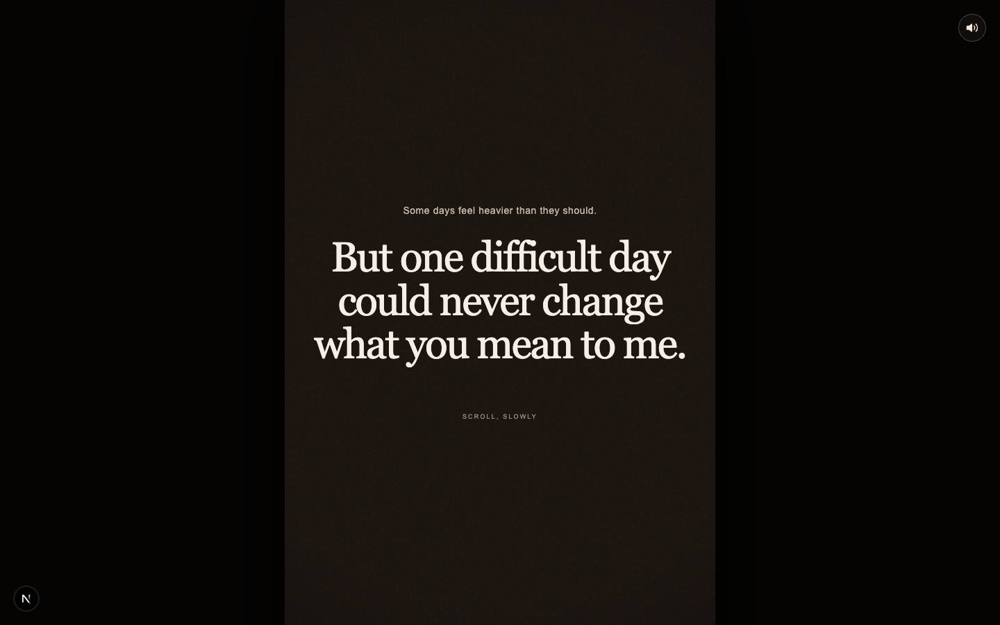
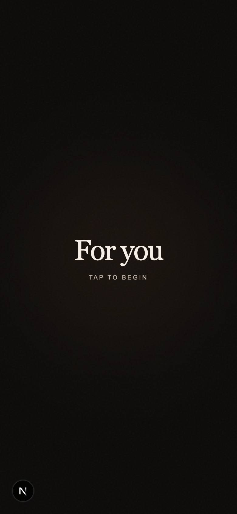

# For You — a scroll story

> A slow, scroll-driven story about the days that feel heavier than they should — built as a Next.js single page.

**Live:** [praashi-rock.vercel.app](https://praashi-rock.vercel.app)

<p align="center">
  
  
  
</p>

## Built with

Next.js · React · TypeScript · Tailwind CSS

## Run locally

```bash
npm install
npm run dev
```

## License

Code is released under the [MIT License](LICENSE). Photos, video, artwork, audio and written content are not covered by it: personal media is © Prawal Sharma, all rights reserved, and third-party assets remain under their own licenses. Music credits and terms: [AUDIO-LICENSE.md](AUDIO-LICENSE.md).
